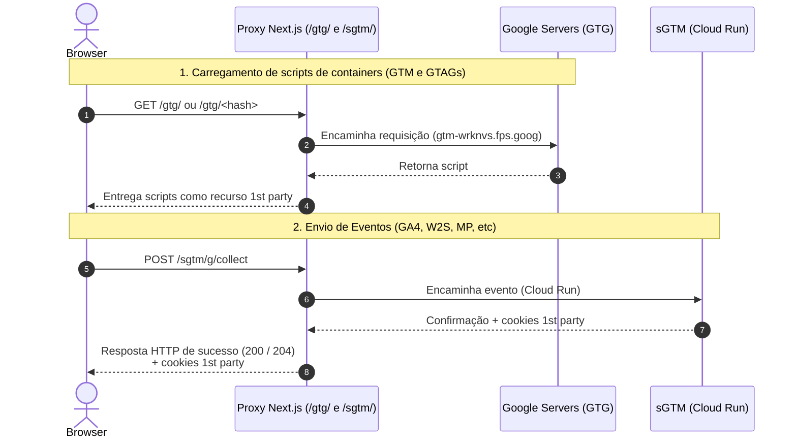

# Proxy GTG + sGTM no Next.js @ Vercel

No Next.js, devemos utilizar [Route Handler](https://nextjs.org/docs/app/getting-started/route-handlers) na implementação do proxy GTG + sGTM.

O Next.js possui a funcionalidade de [proxy](https://nextjs.org/docs/app/api-reference/file-conventions/proxy) (antigo middleware), que é mais simples que o Route Handler, porém não é compatível com a resposta do tipo [HTTP Chunked Transfer Encoding do sGTM](https://stape.io/blog/set-cookie-requests-in-gtm#how-it-works-a-look-under-the-hood) quando usado a query _richsstsse_.

#### Diagrama da arquitetrura:

#### Diagrama do fluxo de requisições

Diagrama de sequência simplificado ilustrando a atuação do Next.js como proxy entre o navegador e os serviços de destino (Google Tag Gateway e Server-Side Tag Manager).

## Getting Started

This is a [Next.js](https://nextjs.org) project bootstrapped with [`pnpm create next-app nextjs-vercel --empty`](https://nextjs.org/docs/app/api-reference/cli/create-next-app).

For development, run `pnpm dev` and open [http://localhost:3000](http://localhost:3000).

Obs: Dev mode is much different from Prod. In particular, these functions don't work in Dev mode:

- CDN/edge cache
- automatic edge resource compression/decompression
- /gtg/ proxy

So, basically it's not possible to test GTG proxy in Dev mode. It must be tested in production.

## Deploy on Vercel

Install vercel cli: `pnpm add -D vercel`

Link this project folder to a Vercel folder, or create a new Vercel project: `pnpm vercel link`

Publish to production: `pnpm vercel --prod`
